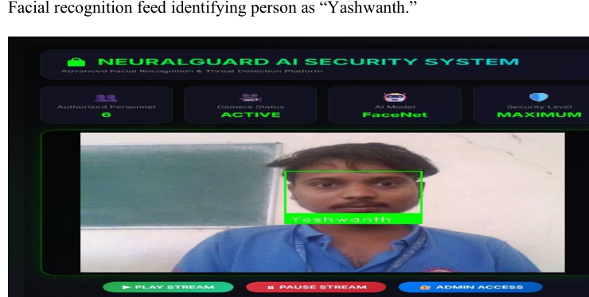
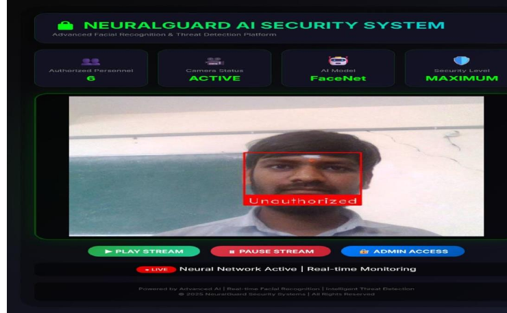
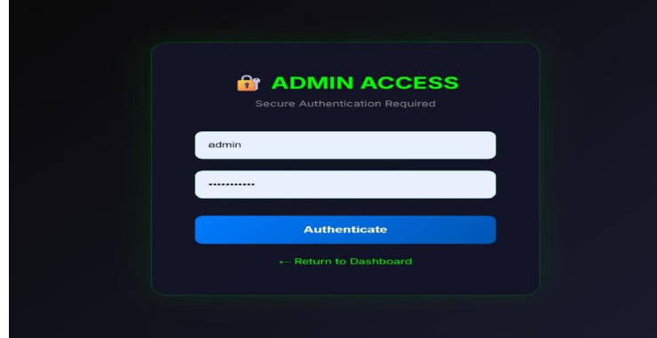
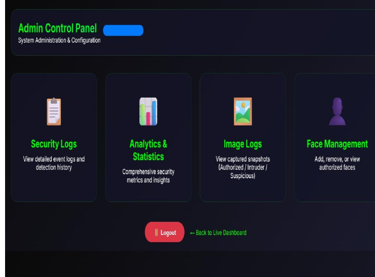
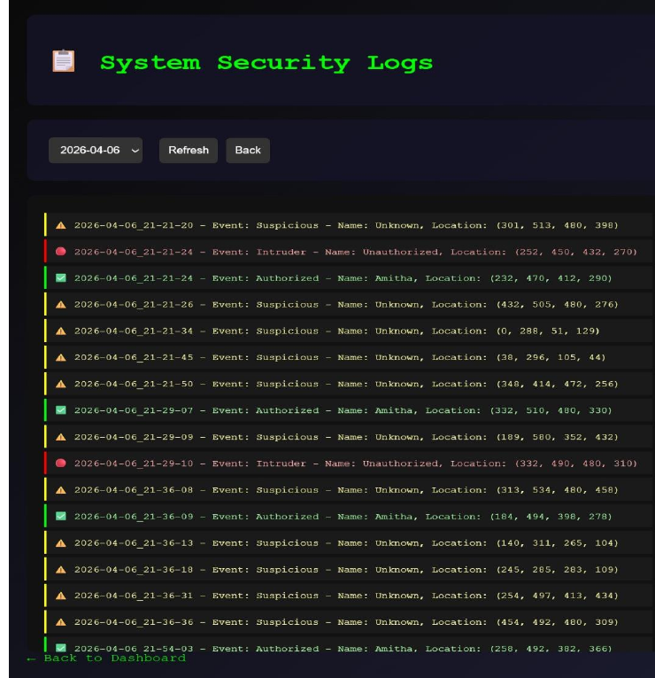
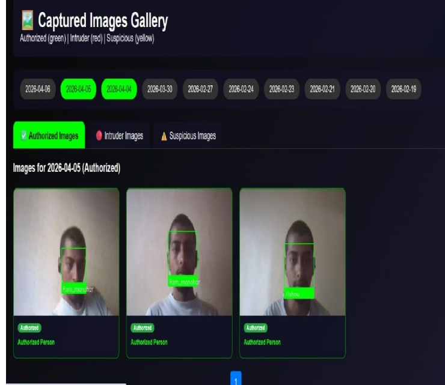
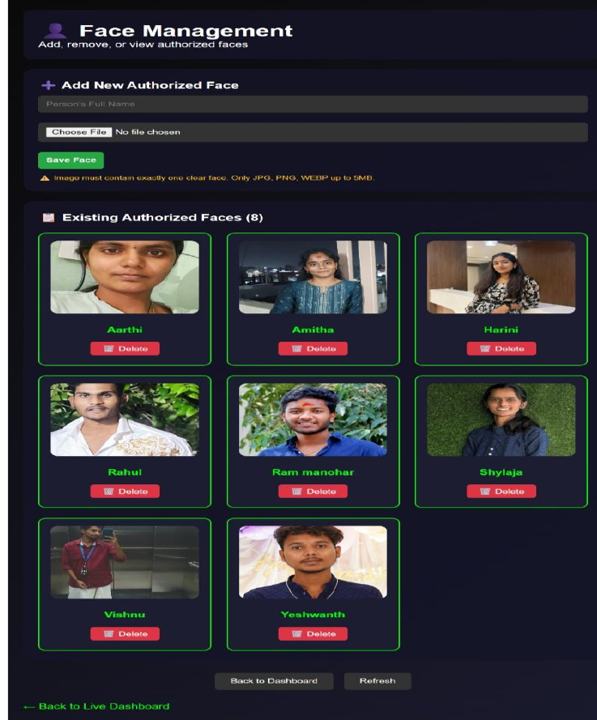

# 🔐 AI-Powered Security Monitoring System

A Python-based security monitoring application built using **Flask, OpenCV, and Face Recognition**. The project demonstrates face recognition, unauthorized-person detection, audio alerts, event logging, and snapshot storage for local experimentation.

## 📌 Project Overview

The AI-Powered Security Monitoring System is designed to demonstrate how computer vision and face recognition can support basic security monitoring.

It uses OpenCV for image processing, face recognition for identifying known faces, and Flask to provide a local web interface.

## ✨ Features

- **Face Recognition:** Identifies faces using the `face_recognition` and OpenCV libraries.
- **Flask Web Interface:** Provides a browser-based interface for local demonstration.
- **Audio Alerts:** Supports sound alerts for detection events.
- **Event Logging:** Records detection events for later review.
- **Snapshot Storage:** Supports storing detection snapshots.
- **Log Summary Generation:** Generates summaries from recorded logs.


## 📸 Project Screenshots

<details>
<summary>View All Project Screenshots (9)</summary>

### 1. Home Page


### 2. Authorized Face Detection


### 3. Unauthorized Face Detection


### 4. Admin Login


### 5. Admin Dashboard


### 6. Security Logs


### 7. Analytics Dashboard


### 8. Image Logs


### 9. Face Management


</details>


## 🛠️ Technology Stack

| Technology | Purpose |
|---|---|
| Python | Main programming language |
| Flask | Web application framework |
| OpenCV | Image and video processing |
| face-recognition | Face identification |
| NumPy | Numerical operations |
| Pygame | Audio alert support |

## ⚙️ How It Works

1. The application starts and initializes its local monitoring interface.
2. OpenCV processes camera frames.
3. Face recognition compares detected faces with authorized face data.
4. Detection events are recorded in the application logs.
5. Audio alerts and snapshot storage support monitoring activities.
6. The summary generator helps review recorded events.

*Note: This workflow describes the intended application flow; individual steps depend on the implemented functionality and configuration.*

## 📂 Project Structure

```text
AI_Security_Project/
│
├── app.py
├── face_detection.py
├── summary_generator.py
├── alert.mp3
├── requirements.txt
├── .env.example
├── .gitignore
├── README.md
│
├── authorized_faces/
│   └── .gitkeep
│
└── logs/
    └── .gitkeep
```

## 🚀 Installation and Setup

### 1. Clone the repository

```bash
git clone https://github.com/katlashylu-cpu/ai-powered-security-monitoring-system.git
```

### 2. Open the project directory

```bash
cd ai-powered-security-monitoring-system
```

### 3. Create a virtual environment

```bash
python -m venv venv
```

### 4. Activate the virtual environment

**Windows:**

```powershell
venv\Scripts\activate
```

**macOS / Linux:**

```bash
source venv/bin/activate
```

### 5. Install dependencies

```bash
pip install -r requirements.txt
```

**Important:** The `face-recognition` package depends on `dlib`. Installation may require additional native build tools, particularly on Windows.

### 6. Add authorized face images

Place the required authorized face images inside the:

```text
authorized_faces/
```

folder, following the format expected by the application.

### 7. Run the application

```bash
python app.py
```

### 8. Open the application

Open the local Flask address printed in the terminal in your web browser.

## 🔒 Security and Privacy Considerations

- This repository is intended for educational purposes, local demonstration, and experimentation. It is not a production-ready security system.
- The original application source contains hardcoded login credentials and a placeholder Flask secret key. Do not deploy this version publicly or use it to protect real systems.
- Proper authentication and secure secret management should be implemented before any real-world deployment.
- Face images, generated snapshots, and runtime logs are not included in the repository.
- Obtain appropriate consent before collecting or processing biometric information.
- Face recognition can produce false matches and missed detections. It should not be used as the sole basis for security decisions.

## ⚠️ Configuration Note

The `.env.example` file is provided as a configuration reference. The unchanged original `app.py` does not currently load environment variables from this file.

## 🔮 Future Improvements

- Secure authentication and environment-based configuration.
- Improved monitoring dashboard.
- Better detection reporting and visualization.
- Enhanced error handling and system performance.
- Additional testing and deployment support.

## 👩‍💻 Author

**Katla Shylaja**

- GitHub: https://github.com/katlashylu-cpu
- LinkedIn: https://www.linkedin.com/in/katla-shylaja-07a919361/
- Portfolio: https://katlashylu-cpu.github.io/portfolio-website/

---

⭐ If you find this project interesting, feel free to explore the repository.
